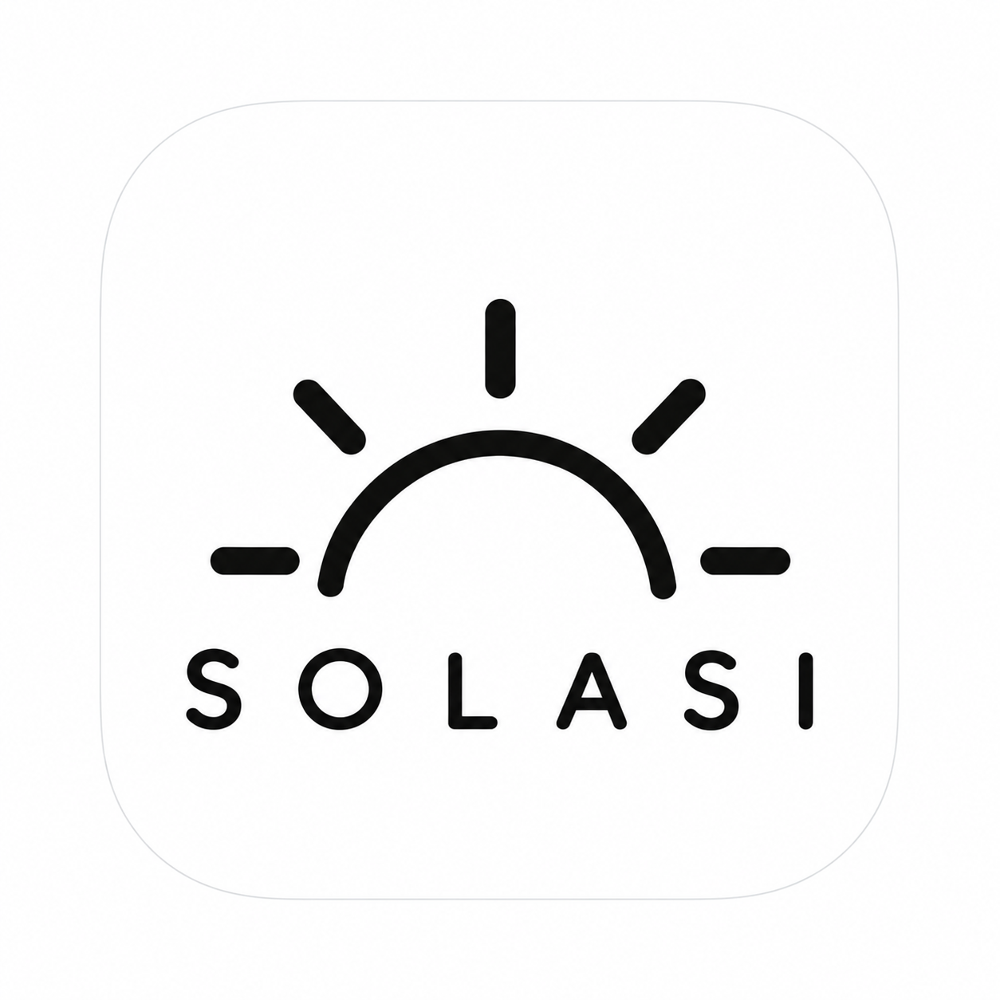

  

<h1 align="center">Solasi</h1>

<strong>듣고, 적고, 다시 찾는 수업·회의 노트.</strong>

  <a href="docs/guide.md">사용 가이드</a> ·
  <a href="docs/development.md#mac-앱-빌드">Mac 앱 빌드</a> ·
  <a href="https://github.com/car1bou/solasi/issues">문제 제보</a>

Solasi는 녹음, 전사, PDF 자료와 필기를 한 기록으로 연결하는 로컬 Mac 앱입니다. 수업은 과목별로 쌓고, 회의는 대화의 근거를 확인하며 정리하세요.

> **Mac Preview · Apple Silicon · macOS 27.0 이상**
>
> 현재는 소스 빌드로 제공됩니다. 다운로드할 수 있는 설치 파일과 공증된 배포판은 아직 제공하지 않습니다.

## 한 흐름으로 이어지는 기록

1. **자료 연결** — 과목을 만들고 PDF·이미지·텍스트 자료를 연결합니다.
2. **메모와 녹음** — PDF 페이지에 필기하고 수업·회의를 녹음합니다.
3. **대본 확인** — 녹음이 끝나면 전사하고, 대본에서 원음을 들으며 수정합니다.
4. **이해와 정리** — 자료와 전사를 함께 질문·요약하고, 필요한 기록을 내보냅니다.

## 주요 기능

| 기능 | 사용 방법 |
| --- | --- |
| **과목별 자료와 기록** | 같은 과목의 공용 PDF·페이지 필기를 회차별 녹음·노트와 함께 관리합니다. |
| **원음을 확인하는 대본** | 문장이나 드래그한 구간을 듣고 수정합니다. 원래 인식문과 이전 버전을 보존합니다. |
| **PDF 위의 필기** | 펜·형광펜·지우개·올가미, 실행 취소·다시 실행, 배율·회전과 페이지 메모를 제공합니다. |
| **근거가 연결된 학습** | 이전 회차까지 검색하고 질문·퀴즈·메모 보강에 사용합니다. |
| **검토할 수 있는 요약·회의록** | 로컬 요약은 핵심 원문 발췌를 우선합니다. 회의록은 결정·담당자·기한의 원문 근거를 확인합니다. |
| **기록 내보내기** | 대본은 TXT·Markdown, 요약·회의록은 Markdown, 페이지 메모·필기는 JSON으로 저장합니다. |

## 시작하기

### 앱이 설치되어 있다면

1. `~/Applications/Solasi.app`을 엽니다.
2. **모델·키 설정**에서 전사 엔진과 사용할 로컬 모델 또는 외부 API를 준비합니다. 다운로드 전 용량·라이선스·저장 위치를 확인할 수 있습니다.
3. 왼쪽에서 과목을 만들고 자료를 연결한 뒤 첫 기록을 시작합니다. 기본 전사 방식은 **녹음 종료 후 처리**이며 실시간 전사는 선택할 수 있습니다.

마이크 권한은 녹음을 시작할 때 요청합니다. 창을 닫아도 진행 중인 작업은 유지되며, 앱 종료는 **⌘Q** 또는 Dock의 **종료**를 사용합니다.

### 처음 설치한다면

[Mac 앱 빌드 안내](docs/development.md#mac-앱-빌드)를 따라 앱과 실행 엔진을 준비하세요. 모델 파일과 사용자 기록은 앱 패키지와 별도로 보관합니다. 빌드 도구는 앱을 만드는 Mac에 필요하며, 만들어진 앱을 실행할 때 Python·Node·개발 소스를 따로 실행할 필요는 없습니다.

## 로컬 저장과 AI 선택

- **녹음·전사·노트·필기는 이 기기에 저장합니다.** Mac 앱은 앱 내부 작업 엔진을 사용하며 앱·모델용 HTTP 서버를 실행하지 않습니다.
- **자료는 원본 위치에 연결합니다.** PDF·이미지·텍스트와 외부 오디오 원본을 중복 복사하지 않습니다. 추출 텍스트·검색 색인·화면 캐시와 앱에서 녹음한 원음은 별도 저장합니다.
- **로컬 AI 또는 외부 API를 선택합니다.** OpenAI·Gemini·Claude를 연결하면 선택한 근거와 이미지를 해당 제공자에 전송합니다. 원음은 로컬에서 전사합니다. 구독 앱 이용권과 API 이용·과금은 별개입니다.
- **웹 검색은 선택 기능입니다.** 별도 Exa 키로 요청한 검색어를 전송하고 외부 출처를 내부 자료와 구분합니다.
- **계정·기기 동기화·클라우드 저장소 연결은 제공하지 않습니다.** 각 기기의 기록은 독립적으로 저장합니다.

전사와 AI 해석에는 누락·오류가 있을 수 있습니다. 대본의 원음과 요약·답변의 원문 근거를 확인하며 사용하세요. [저장·모델·전송 안내](docs/guide.md#저장과-외부-전송)

## 지원 환경

| 환경 | 상태 |
| --- | --- |
| Apple Silicon Mac · macOS 27.0 이상 | 현재 개발·검증 대상 |
| Intel Mac | 지원하지 않음 |
| Windows · Android · iPadOS | 후속 개발 대상, 앱 미제공 |
| 서명·공증된 설치 파일 | 미제공, 현재 로컬 빌드는 ad-hoc 서명 |

깨끗한 Mac에서의 설치와 다른 하드웨어에서의 동작은 별도 검증이 필요합니다. 모델별 메모리·디스크 요구량은 준비 화면에서 확인하세요.

## 문서

- [사용 가이드](docs/guide.md) — 자료·필기·녹음·대본·학습·회의록·내보내기
- [개발 안내](docs/development.md) — Mac 빌드, 이전 버전 이행, 검사 명령과 검증 기록
- [알려진 한계와 개선 항목](docs/improvements.md)
- [공개 저장소에 포함된 범위](PUBLIC_EXPORT.md)
- [런타임·모델 자산과 고지](runtime-manifest.json)

## 피드백과 기여

[Issues](https://github.com/car1bou/solasi/issues)에 사용 환경, 재현 순서, 기대한 동작과 실제 결과를 남겨 주세요. 녹음·전사 원문, API 키와 개인 자료는 공개하지 마세요. 기능 제안과 코드 기여도 Issues와 Pull Request로 받습니다. 개발 환경은 [개발 안내](docs/development.md)를 참고하세요.

## 라이선스

프로젝트 자체의 이용·재배포 라이선스는 아직 지정되어 있지 않습니다. 포함된 외부 구성요소와 모델의 라이선스는 각각 적용됩니다. [런타임 고지](runtime-manifest.json)와 [제3자 라이선스](docs/licenses)를 확인하세요.
